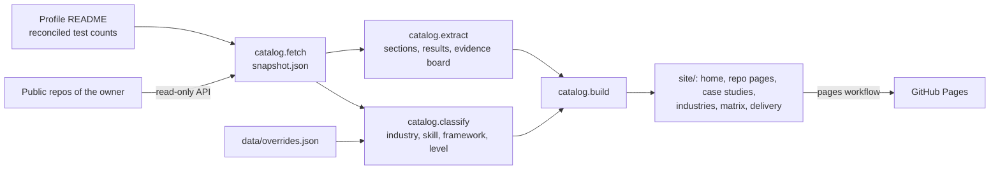

# Jagadish portfolio catalog

**Live site:** https://jagadishmazure-jpg.github.io/Jagadish-portfolio-catalog/

> **Recruiter summary.** Eighty-odd portfolio repos are hard to browse one by one. This repo turns them into one searchable static site: a card per repo, filters by framework, industry and skill, a project page and a case-study page per repo, ten industry solution pages, a capabilities matrix and a delivery-method page. Every page is generated by a rerunnable script from each repo's own README and docs, so numbers on the site are the repos' numbers. At the first build (25 Oct 2026) it listed **82 repos** and **11,936 tests**, matching the profile README. The first live run, minutes later, picked up two newly published repos on its own (84 repos, 12,123 tests). The generator itself has **41 generator tests**.

**Honesty note.** The repos shown are portfolio reference builds made with synthetic data and fictional companies. They are not client deliveries; no client, revenue or production deployment is claimed. Every result on the site is labelled as measured on synthetic data.

## Purpose

- For a hiring manager or a prospective enterprise partner: find the builds relevant to one industry or skill in seconds, then check the evidence in the repo itself.
- For me: one place that updates itself when a new repo (for example the recruiting fairness repo now being built) is published.

## Architecture



## How it works

1. `catalog/fetch.py` lists the owner's public, non-fork, non-archived repos and saves each one's description, topics, README, three optional docs and its file paths. The profile, coordination and catalog repos are skipped.
2. `catalog/classify.py` tags each repo with industries, skills, a framework badge and a level using keyword rules (see [docs/how-it-works.md](docs/how-it-works.md)). `data/overrides.json` fixes the few cases the rules get wrong, each with a reason.
3. `catalog/extract.py` splits the README by headings and picks purpose, architecture, how to run, built vs planned, results, guardrails and limitations. Result lines are lines holding a number and a metric word.
4. `catalog/build.py` writes plain HTML with one stylesheet and one small filter script. No framework, no build tool.
5. `.github/workflows/pages.yml` runs fetch and build on every push, daily, and on demand, then publishes with GitHub Pages.

## Card rules

| Field | Rule |
|---|---|
| Badge | First match: name has langchain/langgraph → LangGraph; playwright → Playwright; README mentions "agent framework" twice → Agent Framework; README mentions LangGraph twice → LangGraph; from-scratch NumPy → NumPy; name has azure/fabric or README mentions Azure 20+ times → Azure; otherwise Python |
| Level | Advanced: 300+ tests, or 150+ with multi-agent. Intermediate: 80+. Beginner: below 80 |
| Tags | Main industry, badge, top two skills |
| Tests | Profile README count (reconciled), else first "N tests" in the repo README, else "not stated" |

## How to run

```bash
python -m venv .venv && . .venv/bin/activate
pip install -r requirements.txt
pytest -q                                          # 41 generator tests
python -m catalog.build tests/fixtures/snapshot.json   # offline build from the fixture
python -m http.server -d site 8000                 # open http://localhost:8000
python -m catalog.fetch                            # live snapshot (needs gh login or GITHUB_TOKEN)
python -m catalog.build                            # full site from data/snapshot.json
```

More in [docs/how-to-run.md](docs/how-to-run.md) and [docs/adding-a-repo.md](docs/adding-a-repo.md).

## Built vs planned

| Item | Status |
|---|---|
| Fetcher, classifier, extractor, static builder | Built, tested |
| Home with search and framework, industry and skill filters | Built |
| Project page and case-study page per repo | Built |
| Ten industry solution pages, capabilities matrix, delivery page | Built |
| Agent cards from any repo's `catalog/agents.json` (agent-card/v1): home section, `agents.html`, industry pages | Built |
| Pages workflow (push, daily, manual) | Built, running |
| CI: lint, tests, docs check, brand check, gitleaks, CodeQL | Built |
| Browser tests of the filter script | Planned |
| Hand-written case-study summaries in place of extracted README text | Planned |
| HR & recruiting domain content | Built: the recruiting fairness repo was picked up automatically on the first live run |

## Guardrails

- Read-only token, public repos only, owner fixed in config. No secrets stored.
- Brand check (hashed blocklist) and gitleaks in CI; the snapshot and built site are not committed.
- Disclaimer on every page; result lists always carry the synthetic-data label (enforced by tests).

## Limitations

Keyword tagging is approximate, extracted text depends on README headings, and result lines are picked by a pattern, not by judgment. Details in [docs/limitations.md](docs/limitations.md).

## Docs

[How it works](docs/how-it-works.md) · [How to run](docs/how-to-run.md) · [Adding a repo](docs/adding-a-repo.md) · [Limitations](docs/limitations.md) · [Threat model](docs/threat-model.md) · [Implementation guide](docs/implementation-guide.md) · [Interview points](docs/interview-points.md) · [ADR 001](docs/adr/001-static-site-from-script.md)

## Related

The [profile README](https://github.com/jagadishmazure-jpg) holds the reconciled per-repo test counts this site reads.
